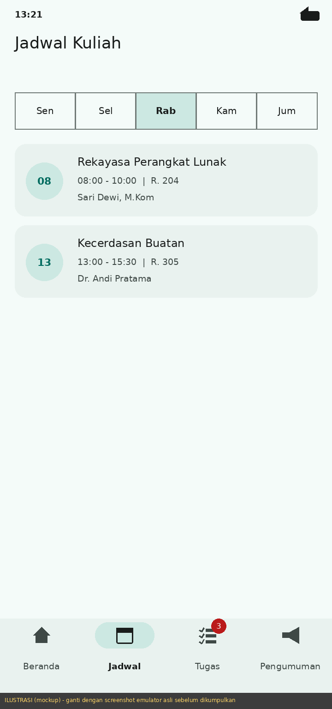
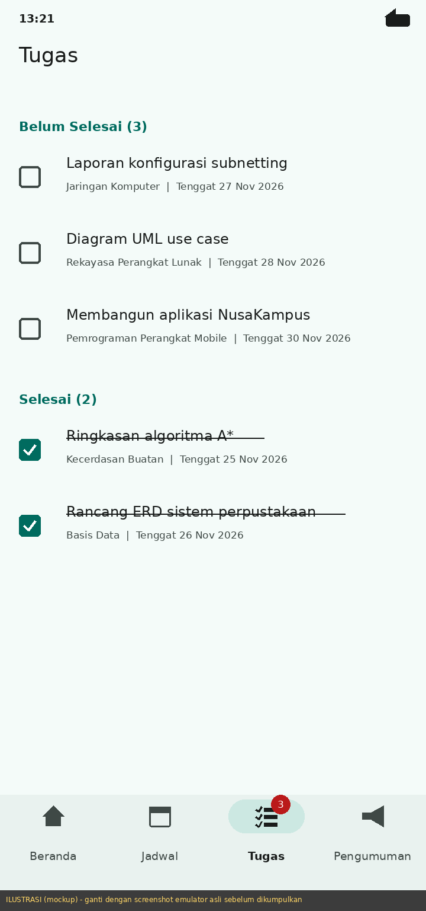
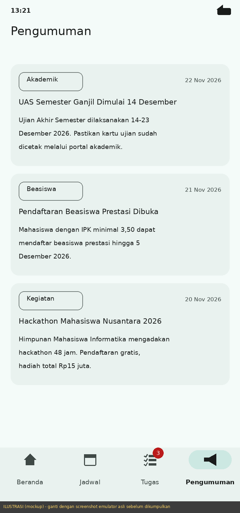
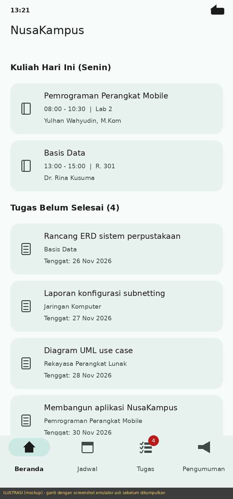
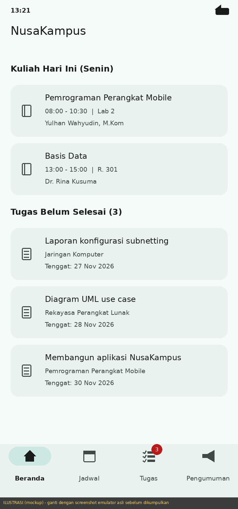
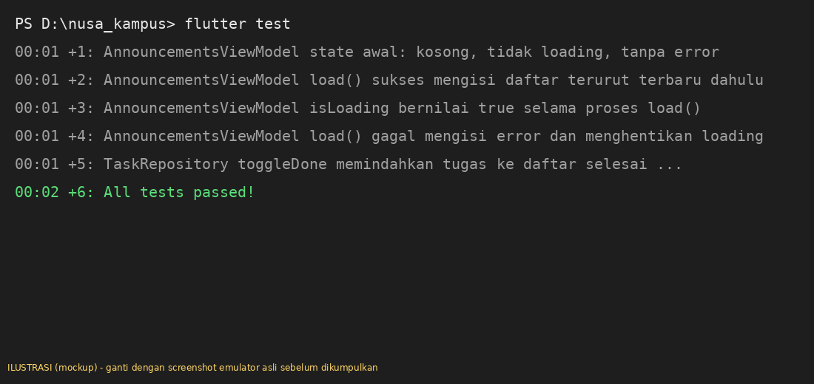

# NusaKampus

Aplikasi kampus sederhana (Flutter) dengan **arsitektur berlapis** sesuai panduan resmi Flutter:
`View → ViewModel → Repository → Service`.

| | |
|---|---|
| **Nama** | Yassin N |
| **NIM** | 20240040127 |
| **Mata Kuliah** | Pemrograman Perangkat Mobile |
| **Dosen Pengampu** | YULHAN WAHYUDIN, M.Kom |
| **Tugas** | Sesi 07 - Membangun Aplikasi Berskala Besar |

## Fitur
- **Beranda** - kuliah hari ini + tugas belum selesai (gabungan `ScheduleRepository` & `TaskRepository`).
- **Jadwal** - jadwal per hari dengan `SegmentedButton` (Senin-Jumat).
- **Tugas** - `CheckboxListTile`; tugas yang dicentang pindah ke bagian *Selesai*; badge jumlah tugas pada tab.
- **Pengumuman** - fitur tambahan: daftar pengumuman kampus (kategori, tanggal, pull-to-refresh).

## Struktur
```
lib/
├── main.dart, app.dart
├── config/dependencies.dart      # MultiProvider (service + repository)
├── domain/models/                # Course, Task (copyWith), Announcement
├── data/services/campus_service.dart       # data contoh + Future.delayed
├── data/repositories/            # Schedule, Task (ChangeNotifier), Announcement
└── ui/ core/ shell/ home/ schedule/ tasks/ announcements/
```

## Menjalankan
```bash
flutter pub get
flutter run
flutter test
```

## Screenshot
| Beranda | Jadwal | Tugas | Pengumuman |
|---|---|---|---|
|  |  |  |  |

**Beranda sebelum & sesudah tugas dicentang**

| Sebelum | Sesudah |
|---|---|
|  |  |

**Hasil `flutter test`**


